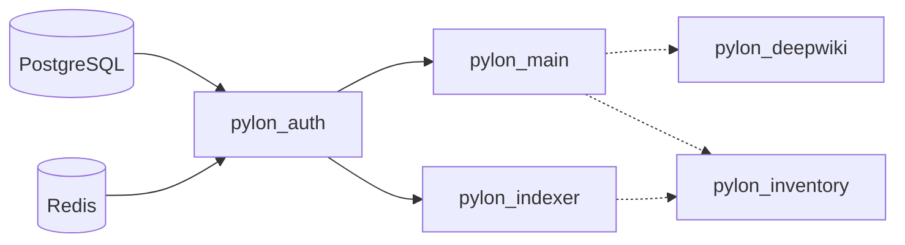

# EliteA Helm Chart

[](https://github.com/EliteaAI/elitea_helm/actions/workflows/ci.yml)
[](https://github.com/EliteaAI/elitea_helm/actions/workflows/release.yml)
[](https://github.com/EliteaAI/elitea_helm/releases/latest)
[](https://github.com/EliteaAI/elitea_helm/blob/main/LICENSE)

Helm chart for the EliteA AI platform (Pylon microservices) on Kubernetes (EKS, GKE, AKS, on-prem).

**Documentation for users of the chart (install, secrets, External Secrets, Argo CD, load balancers, SSO, CA):
[charts/README.md](charts/README.md).**

## Mininal Requirements

| Component | CPU | RAM | PVC | TMP |
| --- | --- | --- | --- | --- |
| `pylon_auth` | 1 | 512Mi | 1Gi | - |
| `pylon_main` | 2 | 6Gi | 25Gi | 20Gi |
| `pylon_indexer` | 6 | 12Gi | 40Gi | 20Gi |
| `redis` | 1 | 512Mi | 1Gi | - |
| `postgresql` | 4 | 16Gi | 250Gi | - |
| `pylon_deepwiki` | 1 | 1Gi | 20Gi | 30Gi |
| `deepwiki_worker` | 2 | 2Gi | - | - |
| `pylon_imagegen` | 500m | 1Gi | 20Gi | 10Gi |
| `pylon_inventory` | 1 | 1Gi | 50Gi | 30Gi |
| `inventory_worker` | 2 | 2Gi | - | - |

CPU and RAM are requests = limits per pod. Indexer sizing (CPU, RAM, PVC) depends on your workload: adjust to available resources.

## Recomended Requirements

| Component | CPU | RAM | PVC | TMP |
| --- | --- | --- | --- | --- |
| `pylon_auth` | 1 | 1Gi | 1Gi | - |
| `pylon_main` | 4 | 12Gi | 60Gi | 20Gi |
| `pylon_indexer` | 4 | 20Gi | 100Gi | 20Gi |
| `redis` | 1 | 512Mi | 1Gi | - |
| `postgresql` | 4 | 24Gi | 250Gi | - |
| `pylon_deepwiki` | 1 | 1Gi | 20Gi | 30Gi |
| `deepwiki_worker` | 4 | 8Gi | - | - |
| `pylon_imagegen` | 500m | 1Gi | 20Gi | 10Gi |
| `pylon_inventory` | 1 | 1Gi | 50Gi | 30Gi |
| `inventory_worker` | 4 | 8Gi | - | - |

## Production Requirements ( 1000 users and more)

| Component | CPU | RAM | PVC | TMP |
| --- | --- | --- | --- | --- |
| `pylon_auth` | 2 | 2Gi | 1Gi | - |
| `pylon_main` | 6 | 32Gi | 80Gi | 20Gi |
| `pylon_indexer` | 6 | 30Gi | 100Gi | 20Gi |
| `redis` | 2 | 6Gi | 1Gi | - |
| `postgresql` | use Cloud SQL 16vCPU, 128 GB RAM, 250 GB SSD |
| `pylon_deepwiki` | 2 | 4Gi | 20Gi | 30Gi |
| `deepwiki_worker` | 4 | 8Gi | - | - |
| `pylon_imagegen` | 1 | 1Gi | 20Gi | 10Gi |
| `pylon_inventory` | 2 | 4Gi | 50Gi | 30Gi |
| `inventory_worker` | 4 | 8Gi | - | - |

## Components

| Component | Template directory | Enabled by |
| --- | --- | --- |
| Pylon Main / Auth / Indexer | `charts/templates/pylon_{main,auth,indexer}/` | always |
| Pylon DeepWiki | `charts/templates/pylon_deepwiki/` | `pylon_deepwiki.enabled` |
| Pylon ImageGen | `charts/templates/pylon_imagegen/` | `pylon_imagegen.enabled` |
| Pylon Inventory | `charts/templates/pylon_inventory/` | `pylon_inventory.enabled` |
| PostgreSQL / Redis | `charts/templates/{postgresql,redis}/` | `embedded_services_pgsql` / `embedded_services_redis` |
| Load balancer (GCE / ALB / AGIC) | `charts/templates/ingress/` | `ingress_enabled` + `cloud_ingress_type` |
| Internal plugin repository | `charts/templates/internal_repo/` | `common.elitea_repo_type: internal` |
| OpenTelemetry Collector | `charts/templates/otel_collector/` | `otel_collector.enabled` |
| MCP Grafana / Azure DevOps | `charts/templates/mcp_{grafana,ado}/` | `mcp_grafana.enabled` / `mcp_ado.enabled` |

## Quick start

```bash
minikube start --cpus 6 --memory 16g --disk-size 60g

./examples/minikube/install.sh               # generates secrets, installs with small local values

kubectl -n elitea port-forward svc/pylon-main-svc 80:8080     # http://localhost:80
```

The default StorageClass is `premium-rwo` (GKE): override `*.storage.class` / `*.persistence.storageClass` elsewhere. Real secrets, StorageClasses and cloud load balancers are covered in [charts/README.md](charts/README.md).

## Key variables

Set these in `common.config` (see [charts/values.yaml](charts/values.yaml)). Wrong values here make the platform misbehave (broken login/cookies, wrong redirects, no DB/Redis connection).

| Variable | Default | Set it when |
| --- | --- | --- |
| `app_host` | `localhost` | **Always**: must match your public DNS name or IP. |
| `app_proto` | `http` | Set `https` if ingress or service uses TLS. |
| `cookies_secure` | `"false"` | Set `"true"` together with `app_proto: https`. |
| `cookies_lifetime` | `604800` | Session lifetime in seconds (e.g. `7200` = 2 h). |
| `postgres_host` / `postgres_port` | empty / `5432` | External PostgreSQL (`embedded_services_pgsql` off). |
| `postgres_db` | `eliteadb` | The database must exist **before** `helm install`. |
| `redis_host` / `redis_port` | empty / `6379` | External Redis (`embedded_services_redis` off). |
| `redis_ssl` | `"false"` | Set `"true"` for TLS Redis (port usually `6380`). |
| `ai_project_allowed_domains` | `centry.user` | Adjust to the user domains allowed to create AI projects and login. |

`debug` (`"false"`) and `sandbox_timeout_seconds` (`30`) are optional tuning.

### Secrets

Set in `common.secrets.*`, or put them all in your own Secret via `common.existingSecret`.

| Key | Generate with | Notes |
| --- | --- | --- |
| `auth.application_auth_secret_key` | `openssl rand 40 \| base64 \| tr '/+' '_-'` | **Required. Never change after first install.** |
| `main.application_main_secret_key` | same | **Required. Never change after first install.** |
| `main.secrets_master_key` | `openssl rand 32 \| openssl base64 -A \| tr '+/' '-_'` | **Required.** Must be a Fernet key. Never change after install. |
| `auth.default_admin_password` | any strong password | Initial admin password. |
| `postgres_user` / `postgres_password` | - | Must exist in PostgreSQL before `helm install`. |
| `redis_password` | - | Leave empty if Redis is not password protected. |
| `hmacs.*` (`rpc`, `event`, `exposure`, `indexer`, `mesh`) | same as above | Auto-generated when `common.secrets.hmac_auto_generate: true` (default). Not available under `helm template`/Argo CD: set them explicitly there. |

## Deployment time

Deployment may take **up to 10 min**, there is pods dependcies to make proper order of starting pylons, seeding  db and initial bootstrap.



Each pod waits for its dependencies in init containers (`wait-postgres`, `wait-redis`, `wait-auth`, `wait-main`, `wait-indexer`).
`pylon_main` and `pylon_indexer` start in parallel once `pylon_auth` is ready. Dotted arrows are optional components.

## Examples (values + External Secrets per cloud)

| Cloud | Files |
|---|---|
| AWS (EKS, ALB, Secrets Manager) | [examples/aws/](examples/aws/) |
| GCP (GKE, GCE ingress, Secret Manager) | [examples/gcp/](examples/gcp/) |
| Azure (AKS, AGIC, Key Vault) | [examples/azure/](examples/azure/) |
| Local (minikube / kind) | [examples/minikube/](examples/minikube/): `./install.sh` creates secrets and installs |
| Local (MicroK8s) | [examples/microk8s/](examples/microk8s/): same as minikube with the `microk8s-hostpath` StorageClass |
| Secrets inside values (tests only) | [examples/inline-secrets/](examples/inline-secrets/) |
| Auto-generated secrets | [examples/autogen-secrets/](examples/autogen-secrets/): HMAC keys and DB passwords are generated, you pass only the 4 encryption keys |

Each folder has `values.yaml` (load balancer, TLS, StorageClasses, `existingSecret`) and `externalsecret.yaml`
(`SecretStore` + `ExternalSecret`). [examples/secret-keys.json](examples/secret-keys.json) lists every key the secret must contain.

```bash
kubectl create namespace elitea

kubectl apply -f examples/aws/externalsecret.yaml          # wait for STATUS SecretSynced

helm install elitea oci://ghcr.io/eliteaai/charts/elitea --version <version> \
  -n elitea -f examples/aws/values.yaml
```

Versions are listed on the [Releases](../../releases) page. To inspect the chart first:
`helm pull oci://ghcr.io/eliteaai/charts/elitea --version <version> --untar`.

Replace the placeholders (domain, certificate, project/vault/region names) first.

## Make targets

Targets take `NS` (namespace, default `test`), `VALS` (values file under `charts/`, default `values.yaml`),
`RELEASE` (default `elitea`) and `KUBE` (Kubernetes version for rendering).

```bash
make lint NS=elitea                         # helm lint --strict
make template NS=elitea VALS=prod.yaml      # render to build/render.yaml
make bump                                   # next version + CHANGELOG (files only, commit in a release PR)
make tag                                    # tag v<chart version> after the release PR is merged
```

With the default `VALS`, `make lint` and `make template` add `charts/ci/test-values.yaml` (dummy secrets).
With your own `VALS` they validate exactly what you pass.

## Repository layout

- [`charts/Chart.yaml`](charts/Chart.yaml), [`charts/values.yaml`](charts/values.yaml), [`charts/values.schema.json`](charts/values.schema.json)
- [`charts/templates/`](charts/templates/) - Kubernetes manifests
- [`charts/data/configs/`](charts/data/configs/) - application-level Pylon config files
- [`charts/ci/`](charts/ci/) - values for lint/CI only (not packaged)
- [`Makefile`](Makefile) - operational commands; `build/` holds rendered output

## Configuration model

Two layers:

- Environment ConfigMaps from `charts/templates/<component>/config.yml`
  (`common.config` overridden by `pylon_X.config`)
- Pylon application configs in `charts/data/configs/<component>/`: `.yml` files are loaded as-is,
  `.yml.tpl` files go through Helm `tpl`.

Use Helm values for structural decisions (plugins, load order). Use `${ENV_VAR}` placeholders for secrets and
runtime values: they are resolved in the container from the pod environment, not at render time.

## Notes

- Queue names use `redis_queue_random_suffix` to avoid collisions when several installations share Redis.
- VPA objects are emitted only when the matching `resources.vpa_enabled` is true.
- Never commit real secrets. Use `common.existingSecret` (see charts/README.md).
